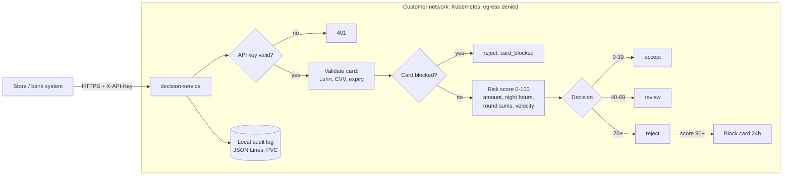
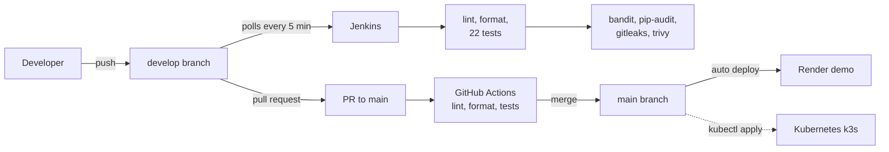

# Veloce AI

**An on-prem fraud gatekeeper for card payments.** It runs inside the store or bank
network, decides on every transaction in under 15 ms, and keeps card data off the internet.

This repository is a DevOps project: the decision service is the workload, and the focus
is on how it is built, tested, secured, shipped and run.

| | |
|---|---|
| **Live API (demo)** | https://veloce-decision-service.onrender.com/docs |
| **Website** | https://veloce-ai-demo.vercel.app |
| **Roadmap** | [ROADMAP.md](ROADMAP.md) |

> Demo environment only. Use the test card `4242 4242 4242 4242`.

## The problem

Today a card payment is usually sent to a fraud engine in a remote cloud. That adds
latency at the checkout and sends card data across the public internet.

## Product promises, and how this repo backs each one

| Promise | Status | How it is backed today |
|---|---|---|
| Runs on-prem | Live | Hardened container on Kubernetes (k3s): non-root, read-only filesystem, probes, resource limits |
| Decides in under 15 ms | Live | Local rule engine, no network calls in the decision path (measured below 1 ms) |
| Card data never leaves | Live | NetworkPolicy denies all outbound traffic from the pod; local audit log; card number masked; CVV never stored; API key required |
| AI reviews every rule change | Planned | Rule-review agent reads the diff and flags critical findings; not yet a pipeline gate |
| Control from the phone | Partly | Card blocking API is live; alerts to the phone are planned |

## Architecture



### Card blocking without storing card numbers

A rejection with risk score 90 or more blocks the card for 24 hours, and the security
manager can block, list and release cards through `/blocks`. A blocked card is identified
by an HMAC-SHA256 of its number keyed with `CARD_HASH_KEY`: the same card always gives the
same code, the code cannot be turned back into the number, and only blocked cards get one.

## Delivery pipeline



- **Two branches:** `develop` is where work happens and Jenkins checks every commit.
  `main` is stable; it changes only through a pull request with green checks.
- **DevSecOps:** every commit is scanned for vulnerable code (bandit), vulnerable
  dependencies (pip-audit), secrets anywhere in git history (gitleaks), and
  vulnerabilities or misconfigurations in files and the Dockerfile (trivy).
- **Fail fast:** a red build on `develop` never reaches production.

## Kubernetes

Manifests in [`k8s/`](k8s/): Namespace, Deployment, Service, PersistentVolumeClaim for the
audit log, and a NetworkPolicy.

```bash
k3d cluster create veloce
docker build -t veloce/decision-service:dev services/decision-service
k3d image import veloce/decision-service:dev -c veloce
kubectl apply -f k8s/namespace.yaml
kubectl create secret generic decision-service-secrets -n veloce \
  --from-literal=API_KEY="$(python3 -c 'import secrets; print(secrets.token_urlsafe(32))')" \
  --from-literal=CARD_HASH_KEY="$(python3 -c 'import secrets; print(secrets.token_urlsafe(32))')"
kubectl apply -f k8s/
kubectl port-forward -n veloce svc/decision-service 8002:80
```

Prove that nothing can leave the pod:

```bash
kubectl exec -n veloce deploy/decision-service -- \
  python -c "import urllib.request; urllib.request.urlopen('https://example.com', timeout=5)"
# fails: outbound traffic is denied
```

k3s enforces NetworkPolicy out of the box; Docker Desktop's built-in Kubernetes does not.

## Engineering decisions

| Decision | Why |
|---|---|
| NetworkPolicy denies all egress | "Data never leaves" is enforced by the network, not only by the code (defense in depth) |
| Card blocked by HMAC, not by number | The blocklist works without storing card numbers; useless without the key |
| Audit log on local disk, not S3 | Uploading inside the request broke the 15 ms budget and sent card data off-site |
| API key and hash key **fail closed** | A server with a missing key rejects every request (503) instead of running open |
| Constant-time key comparison | `secrets.compare_digest` prevents timing attacks |
| Non-root, read-only container, all capabilities dropped | A compromised process can neither escalate nor change files |
| Secrets never in git | `.env` locally, Kubernetes Secret created with `kubectl`, Render environment variables |
| `.vercelignore` allowlist | Only the website is uploaded; secrets and services can never be published by mistake |
| One replica for now | Decisions, velocity and blocks are in memory; Redis is next, then more replicas |
| Velocity counted per customer | Counting all traffic flagged honest customers during busy hours (found and fixed with a regression test) |

## Run it locally with Docker

```bash
cd services/decision-service
cp .env.example .env    # then set API_KEY and CARD_HASH_KEY
docker compose up -d --build
curl localhost:8001/health
```

API docs: http://localhost:8001/docs (click **Authorize** and enter the key).

### Checks (same as CI)

```bash
cd services/decision-service
python3.12 -m venv .venv && .venv/bin/pip install -r requirements-dev.txt
.venv/bin/ruff check app tests
.venv/bin/ruff format --check app tests
.venv/bin/pytest -q
.venv/bin/bandit -r app --severity-level medium
.venv/bin/pip-audit -r requirements.txt
```

## Repository layout

```
services/decision-service/   decision API (FastAPI), tests, Dockerfile, docker-compose
k8s/                         Kubernetes manifests
agents/rule-review/          AI reviewer for rule changes
jenkins/Dockerfile           Jenkins image with Python, trivy and gitleaks
Jenkinsfile                  Jenkins pipeline with security scans
.github/workflows/           GitHub Actions pipeline
render.yaml                  demo deployment of the API
index.html, assets/          website on Vercel
ROADMAP.md                   what is built and what comes next
```

## What comes next

Redis for shared state (then more replicas), Prometheus and Grafana with a 15 ms SLO
alert to Telegram, the AI reviewer as a pipeline gate, a Helm chart and GitOps with Flux,
and Terraform. Details in [ROADMAP.md](ROADMAP.md).
