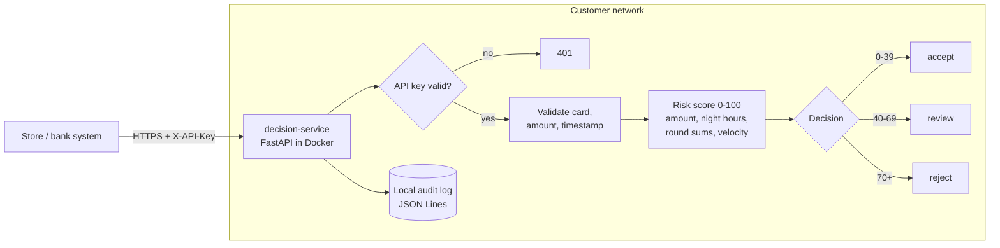
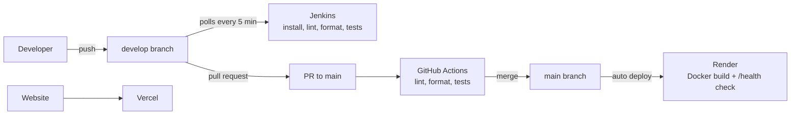

# Veloce AI

**An on-prem fraud gatekeeper for card payments.** It runs inside the store or bank
network, decides on every transaction in under 15 ms, and keeps card data off the internet.

This repository is a DevOps project: the decision service is the workload, and the focus
is on how it is built, tested, secured, shipped and run.

| | |
|---|---|
| **Live API (demo)** | https://veloce-decision-service.onrender.com/docs |
| **Website** | https://veloce-ai-demo.vercel.app |
| **Roadmap** | [ROADMAP.md](ROADMAP.md) |

> Demo environment only. Use the test card `4242 4242 4242 4242`.

## The problem

Today a card payment is usually sent to a fraud engine in a remote cloud. That adds
latency at the checkout and sends card data across the public internet.

## Product promises, and how this repo backs each one

| Promise | How it is backed today |
|---|---|
| Runs on-prem | Containerized service (multi-stage image, non-root user, healthcheck) |
| Decides in under 15 ms | Local rule engine, no network calls in the decision path (measured below 1 ms) |
| Card data never leaves | Local append-only audit log, card number masked, CVV never stored, API key required |
| AI reviews every rule change | Rule-review agent reads the diff and fails on critical findings; changes reach `main` only through a PR with CI |
| Control from the phone | Planned: blocking API, alerts to Telegram (see roadmap) |

## Architecture



## Delivery pipeline



- **Two branches:** `develop` is where work happens and Jenkins checks every commit.
  `main` is stable; it changes only through a pull request with green checks, and it is
  what Render deploys.
- **Fail fast:** a red build on `develop` never reaches production.

## Engineering decisions

| Decision | Why |
|---|---|
| Audit log on local disk, not S3 | Uploading inside the request broke the 15 ms budget and sent card data off-site |
| API key with **fail closed** | A server with no key configured rejects every request (503) instead of running open |
| Constant-time key comparison | `secrets.compare_digest` prevents timing attacks |
| Non-root container | A compromised process gets no root inside the container |
| `.vercelignore` allowlist | Only the website is uploaded; secrets and services can never be published by mistake |
| Secrets only in the environment | `.env` locally, Render environment variables in the demo, never in git |
| Velocity counted per customer | Counting all traffic flagged honest customers during busy hours (found and fixed with a regression test) |

## Run it locally

```bash
cd services/decision-service
echo "API_KEY=change-me" > .env
docker compose up -d --build
curl localhost:8001/health
```

API docs: http://localhost:8001/docs (click **Authorize** and enter the key).

### Checks (same as CI)

```bash
cd services/decision-service
python3.12 -m venv .venv && .venv/bin/pip install -r requirements-dev.txt
.venv/bin/ruff check app tests
.venv/bin/ruff format --check app tests
.venv/bin/pytest -q
```

## Repository layout

```
services/decision-service/   decision API (FastAPI), tests, Dockerfile, docker-compose
agents/rule-review/          AI reviewer for rule changes
jenkins/Dockerfile           local Jenkins image with Python
Jenkinsfile                  Jenkins pipeline
.github/workflows/           GitHub Actions pipeline
render.yaml                  demo deployment of the API
index.html, vercel.json      website on Vercel
ROADMAP.md                   what is built and what comes next
```

## What comes next

Card blocking, Redis for shared state, Kubernetes with Helm and a NetworkPolicy that
denies outbound traffic, Prometheus and Grafana with a 15 ms SLO alert to Telegram,
security scanning in CI, and Terraform. Details in [ROADMAP.md](ROADMAP.md).
