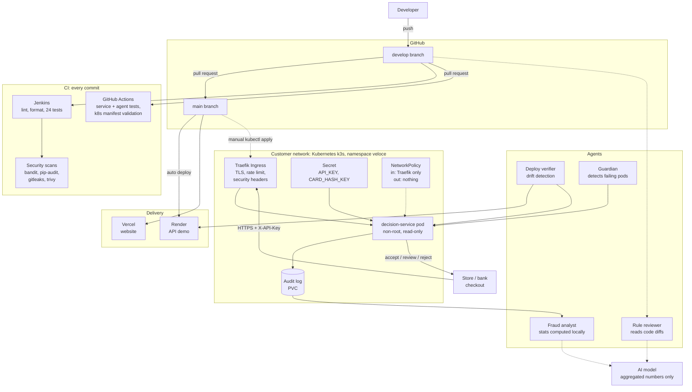
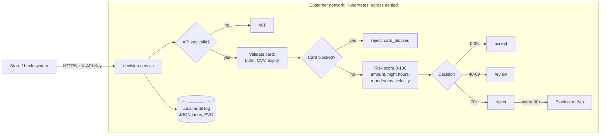
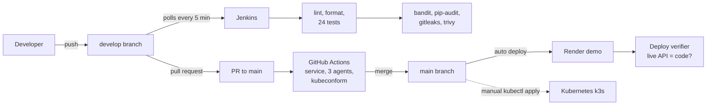

# Veloce AI

**An on-prem fraud gatekeeper for card payments.** It runs inside the store or bank
network, decides on every transaction in under 15 ms, and keeps card data off the internet.

This repository is a DevOps project: the decision service is the workload, and the focus
is on how it is built, tested, secured, shipped and run.

| | |
|---|---|
| **Live API (demo)** | https://veloce-decision-service.onrender.com/docs |
| **Website** | https://veloce-ai-demo.vercel.app |
| **Roadmap** | [ROADMAP.md](ROADMAP.md) |

> Demo environment only. Use the test card `4242 4242 4242 4242`.

## System overview



Solid lines run today; dotted lines are partly built or planned.

## The problem

Today a card payment is usually sent to a fraud engine in a remote cloud. That adds
latency at the checkout and sends card data across the public internet.

## Product promises, and how this repo backs each one

| Promise | Status | How it is backed today |
|---|---|---|
| Runs on-prem | Live | Hardened container on Kubernetes (k3s): non-root, read-only filesystem, probes, resource limits |
| Decides in under 15 ms | Built, not yet load-tested | Local rule engine, no network calls in the decision path; a k6 load test with a p99 target is next |
| Card data never leaves | Live | NetworkPolicy denies all outbound traffic from the pod; local audit log; card number masked; CVV never stored; API key required |
| AI reviews every rule change | Planned | Rule-review agent reads the diff and flags critical findings; not yet a pipeline gate |
| Control from the phone | Partly | Card blocking API is live; alerts to the phone are planned |

## Architecture



### Card blocking without storing card numbers

A rejection with risk score 90 or more blocks the card for 24 hours, and the security
manager can block, list and release cards through `/blocks`. A blocked card is identified
by an HMAC-SHA256 of its number keyed with `CARD_HASH_KEY`: the same card always gives the
same code, the code cannot be turned back into the number, and only blocked cards get one.

## Delivery pipeline



- **Two branches:** `develop` is where work happens and Jenkins checks every commit.
  `main` is stable and changes through pull requests; enforcing green checks with a
  branch ruleset is the next step.
- **What GitHub Actions checks:** the decision service (lint, format, tests), each agent in
  a parallel matrix job, and every Kubernetes manifest against the API schema of the
  cluster version with kubeconform, so a typo fails the pull request instead of `kubectl apply`.
- **DevSecOps:** Jenkins scans every commit for vulnerable code (bandit), vulnerable
  dependencies (pip-audit), secrets anywhere in git history (gitleaks), and
  vulnerabilities or misconfigurations in files and the Dockerfile (trivy).
- **Pinned versions:** application dependencies and CI tools use exact versions, so a
  build gives the same result today and next month, locally and in CI.
- **Drift detection:** the deploy verifier compares the endpoints the live API serves with
  the endpoints in the code. It found the Render demo deploying from an old branch,
  43 commits behind `main`; after the fix it passes 5/5 checks.

## Kubernetes

The cluster itself is code in [`k3d/cluster.yaml`](k3d/cluster.yaml): one server, two
agents, a pinned k3s version, and only port 8443 (HTTPS) opened.

| Manifest | What it does |
|---|---|
| `namespace.yaml`, `deployment.yaml`, `service.yaml` | The service, hardened: non-root, read-only filesystem, probes, limits, PVC for the audit log |
| `certificate.yaml` | cert-manager: a local CA and a TLS certificate for `veloce.localhost` |
| `ingress.yaml` | Traefik on HTTPS only; plain HTTP is never served |
| `middlewares.yaml` | Rate limit (10 req/s per client, burst 20, then 429) and security headers (HSTS, nosniff, frame deny, no server header) |
| `networkpolicy.yaml` | In: only Traefik may reach the pod. Out: nothing may leave it |

```bash
# 1. Cluster and cert-manager
k3d cluster create --config k3d/cluster.yaml
kubectl apply -f https://github.com/cert-manager/cert-manager/releases/download/v1.21.2/cert-manager.yaml
kubectl wait --for=condition=Available deployment --all -n cert-manager --timeout=180s

# 2. Image and secret
docker build -t veloce/decision-service:dev services/decision-service
k3d image import veloce/decision-service:dev -c veloce
kubectl apply -f k8s/namespace.yaml
kubectl create secret generic decision-service-secrets -n veloce \
  --from-literal=API_KEY="$(python3 -c 'import secrets; print(secrets.token_urlsafe(32))')" \
  --from-literal=CARD_HASH_KEY="$(python3 -c 'import secrets; print(secrets.token_urlsafe(32))')"

# 3. Everything else
kubectl apply -f k8s/
kubectl -n veloce rollout status deployment/decision-service

# 4. Trust the local CA and call the API over HTTPS
kubectl get secret veloce-local-ca -n cert-manager -o jsonpath='{.data.ca\.crt}' | base64 -d > veloce-ca.crt
curl --cacert veloce-ca.crt https://veloce.localhost:8443/health
```

Prove each security layer:

```bash
# HTTPS only: plain HTTP is not served
curl -s -o /dev/null -w "%{http_code}\n" http://veloce.localhost:8443/health        # 404

# Rate limit: 200 fast requests, the extra ones get 429
for i in $(seq 200); do curl -s -o /dev/null -w "%{http_code}\n" --cacert veloce-ca.crt \
  https://veloce.localhost:8443/health; done | sort | uniq -c

# Ingress policy: a pod inside the cluster cannot skip Traefik
kubectl run attacker --rm -i --restart=Never -n veloce --image=curlimages/curl -- \
  curl -s -m 3 http://decision-service/health                                        # times out

# Egress policy: nothing can leave the pod
kubectl exec -n veloce deploy/decision-service -- \
  python -c "import urllib.request; urllib.request.urlopen('https://example.com', timeout=5)"  # fails
```

k3s enforces NetworkPolicy out of the box; Docker Desktop's built-in Kubernetes does not.

## Engineering decisions

| Decision | Why |
|---|---|
| NetworkPolicy denies all egress | "Data never leaves" is enforced by the network, not only by the code (defense in depth) |
| Only Traefik may reach the pod | A compromised pod elsewhere in the cluster cannot skip TLS, the rate limit and the security headers |
| Rate limit at the Ingress, not in Python | A flood is refused with 429 before it reaches the service, so real decisions keep their latency |
| Exact versions for dependencies and CI tools | An unpinned linter once passed locally (ruff 0.16) and failed in CI (ruff 0.17) on the same code |
| Deploy verifier compares live endpoints with the code | Configuration drift is found by a check, not by a customer |
| Card blocked by HMAC, not by number | The blocklist works without storing card numbers; useless without the key |
| Audit log on local disk, not S3 | Uploading inside the request broke the 15 ms budget and sent card data off-site |
| API key and hash key **fail closed** | A server with a missing key rejects every request (503) instead of running open |
| Constant-time key comparison | `secrets.compare_digest` prevents timing attacks |
| Non-root, read-only container, all capabilities dropped | A compromised process can neither escalate nor change files |
| Secrets never in git | `.env` locally, Kubernetes Secret created with `kubectl`, Render environment variables |
| `.vercelignore` allowlist | Only the website is uploaded; secrets and services can never be published by mistake |
| One replica for now | Decisions, velocity and blocks are in memory; Redis is next, then more replicas |
| Velocity counted per customer | Counting all traffic flagged honest customers during busy hours (found and fixed with a regression test) |

## API

All endpoints except `/health` and `/readiness` require the `X-API-Key` header.

| Method | Path | Purpose |
|---|---|---|
| POST | `/decide_transaction` | Validate, score and decide on a transaction |
| GET | `/decisions/{decision_id}` | Read a stored decision |
| POST | `/get_check_transaction` | Read a decision and record the check in the audit log |
| POST | `/blocks` | Block a card (security manager) |
| GET | `/blocks` | List blocked cards (last 4 digits only) |
| DELETE | `/blocks/{block_id}` | Release a card |
| GET | `/calculate_geo_risk` | Geo risk for an IP country vs card country |
| GET | `/health`, `/readiness` | Probes, open without a key |

### Environment

| Variable | Required | Purpose |
|---|---|---|
| `API_KEY` | yes | Key clients send in `X-API-Key` |
| `CARD_HASH_KEY` | yes | Secret for the HMAC that identifies blocked cards |
| `AUDIT_LOG_PATH` | no | Local audit log file (JSON Lines); empty disables auditing |

Without `API_KEY` or `CARD_HASH_KEY` the service fails closed and answers 503.
Generate a key with `python3 -c "import secrets; print(secrets.token_urlsafe(32))"`.

## Run it locally with Docker

```bash
cd services/decision-service
cp .env.example .env    # then set API_KEY and CARD_HASH_KEY
docker compose up -d --build
curl localhost:8001/health
```

API docs: http://localhost:8001/docs (click **Authorize** and enter the key).

### Checks (same as CI)

```bash
cd services/decision-service
python3.12 -m venv .venv && .venv/bin/pip install -r requirements-dev.txt
.venv/bin/ruff check app tests
.venv/bin/ruff format --check app tests
.venv/bin/pytest -q
.venv/bin/bandit -r app --severity-level medium
.venv/bin/pip-audit -r requirements.txt
```

Agents (from each agent folder, for example `agents/guardian`):

```bash
pytest -q
```

Check that the live environments match the code:

```bash
services/decision-service/.venv/bin/python agents/deploy-verifier/verifier.py --k8s-ca veloce-ca.crt
```

## Repository layout

```
services/decision-service/   decision API (FastAPI), tests, Dockerfile, docker-compose
k3d/cluster.yaml             the local Kubernetes cluster as code
k8s/                         Kubernetes manifests: service, TLS, Ingress, middlewares, NetworkPolicy
agents/deploy-verifier/      checks that Render, Kubernetes and the website run what the code says
agents/guardian/             detects failing pods (step 1 of detect, diagnose, fix with approval)
agents/rule-review/          AI reviewer for rule changes
agents/fraud-analyst/        AI analyst: fraud statistics report from the audit log
jenkins/Dockerfile           Jenkins image with Python, trivy, gitleaks and the Docker CLI
Jenkinsfile                  Jenkins pipeline with security scans
.github/workflows/           GitHub Actions: service, agents, Kubernetes manifests
render.yaml                  demo deployment of the API
index.html, assets/          website on Vercel
ROADMAP.md                   what is built and what comes next
```

## What comes next

Continuous delivery from Jenkins to Kubernetes (image tagged with the commit SHA, Trivy image
scan, rollout, deploy verifier, automatic rollback), a branch ruleset on `main`, a k6 load
test for the 15 ms promise, Prometheus and Grafana with an SLO alert to Telegram, Redis for
shared state, and a Helm chart. Details in [ROADMAP.md](ROADMAP.md).
